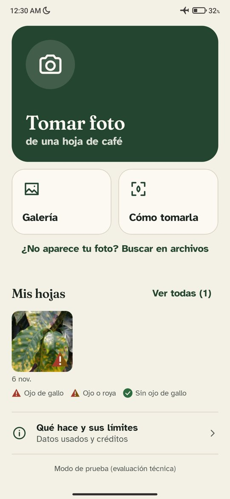
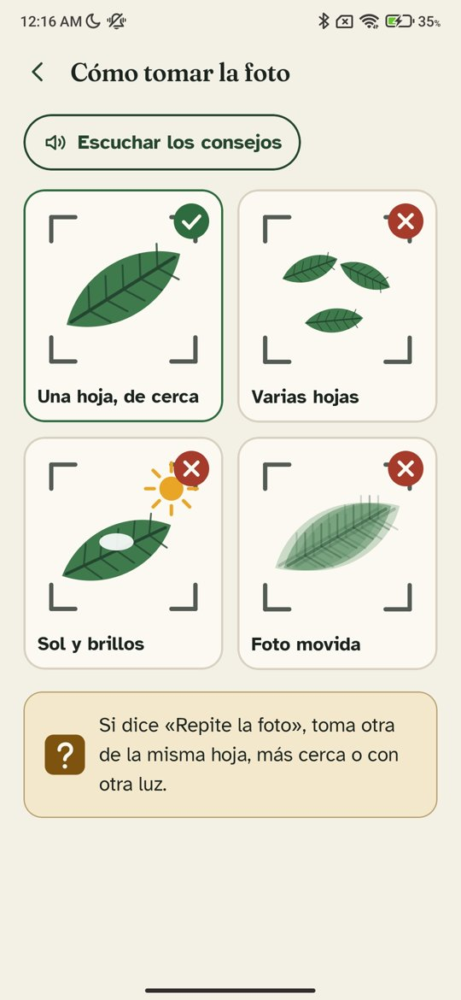
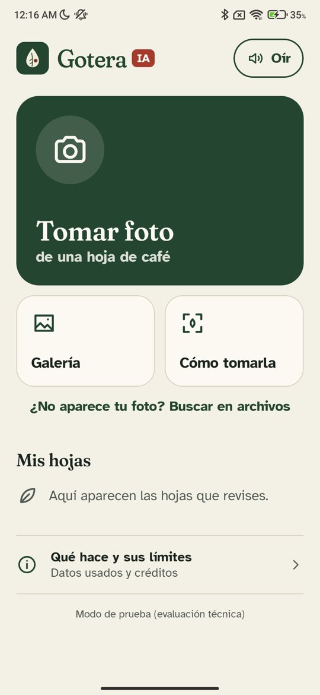
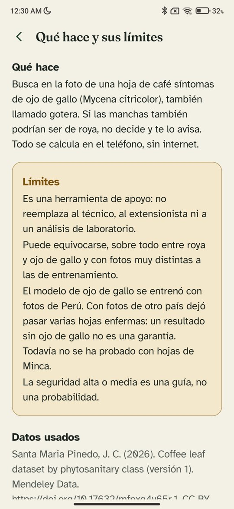

# Gotera IA

Aplicación Android que diagnostica la enfermedad **ojo de gallo del cafeto** (*Mycena citricolor*) a partir de una foto de la hoja, **sin conexión a internet**: los tres modelos de visión por computadora se ejecutan dentro del teléfono.

Trabajo de grado de Ingeniería de Software, Universidad Cooperativa de Colombia, Santa Marta (2026). Autor: **Rodrigo Manuel Alfaro Giraldo**.

<p>




</p>

## Qué hace

1. El caficultor toma o elige la foto de una hoja.
2. Un **filtro de calidad** descarta imágenes casi lisas.
3. Un **verificador** comprueba que sea una hoja de café.
4. El **modelo de diagnóstico** calcula la probabilidad de ojo de gallo promediando 4 vistas de la imagen.
5. Si la probabilidad es alta, un **detector de roya** decide si conviene abstenerse ("ojo de gallo o roya").
6. Una **regla de decisión** entrega el resultado, la seguridad y la acción recomendada; el resultado se puede **escuchar en voz alta** y queda en el historial "Mis hojas".

## Tecnologías

| Área | Herramientas |
|---|---|
| App | Kotlin 2.1, Jetpack Compose (Material 3), arquitectura MVVM, CameraX, Room (SQLite), TextToSpeech |
| IA en el dispositivo | LiteRT 1.4 (TensorFlow Lite), 3 modelos float16 (5,84 MB en total) |
| Entrenamiento | Python, TensorFlow/Keras, MobileNetV3Small con aprendizaje por transferencia, Google Colab |
| Pruebas | JUnit (16 pruebas de la regla de decisión), prueba instrumentada de equivalencia Python–Android |

Android 8.0 o superior (minSdk 26). Probada en un Redmi Note 8 (Android 11) y en un emulador con Android 14.

## Resultados medidos

- **Rendimiento:** en un Redmi Note 8 sin conexión, el análisis tardó 361,59 ms en promedio y **396,81 ms en el percentil 95** (requisito: 2 s o menos).
- **Equivalencia:** con 40 imágenes, la app en Android y la réplica en Python dieron el mismo resultado en las 40 (diferencia máxima de probabilidad 0,0000007).
- **Usabilidad:** puntaje SUS de **94,5** con 10 participantes.

## Estructura

```
app/src/main/java/co/edu/ucc/ojodegallo/
├── ml/     Preprocesador, Clasificador y ReglaDecision
├── data/   base de datos Room e historial (CRUD)
└── ui/     pantallas Compose, modelo de vista, cámara y voz
app/src/main/assets/       los tres modelos .tflite y el umbral del detector
app/src/test/              pruebas unitarias (ReglaDecisionTest)
app/src/androidTest/       prueba de equivalencia Python–Android
entrenamiento/             cuadernos de Colab y scripts de la Fase 1 (entrenamiento, conversión a TFLite, auditorías)
equivalencia/              réplica en Python de la app y scripts de comparación
```

## Compilar y probar

```bash
./gradlew assembleDebug          # APK en app/build/outputs/apk/debug/
./gradlew testDebugUnitTest      # pruebas unitarias
```

En Windows use `gradlew.bat`. La primera vez Gradle necesita internet para descargar las dependencias.

> Las 40 fotos originales de la prueba de equivalencia no se incluyen por tamaño; el repositorio trae las entradas ya preprocesadas (`androidTest/assets/equivalencia/entradas`).

## Datos

El modelo de diagnóstico se entrenó con 999 imágenes públicas de hojas de café de Perú; la validación externa usó imágenes de Costa Rica. El siguiente paso es incorporar imágenes de fincas colombianas (Minca, Sierra Nevada de Santa Marta) para ajustar el modelo a las condiciones locales.

## Autor

Rodrigo Manuel Alfaro Giraldo · rodrigoalfaro1903@gmail.com · [github.com/rodrigo-manuel](https://github.com/rodrigo-manuel)
